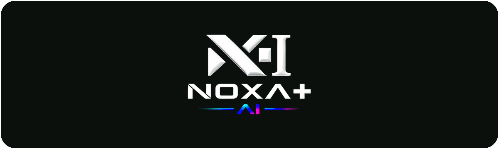
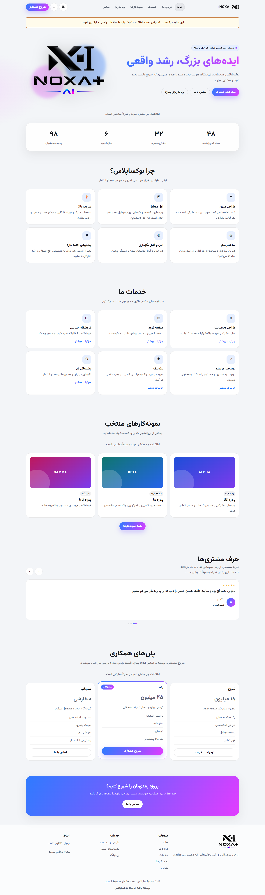
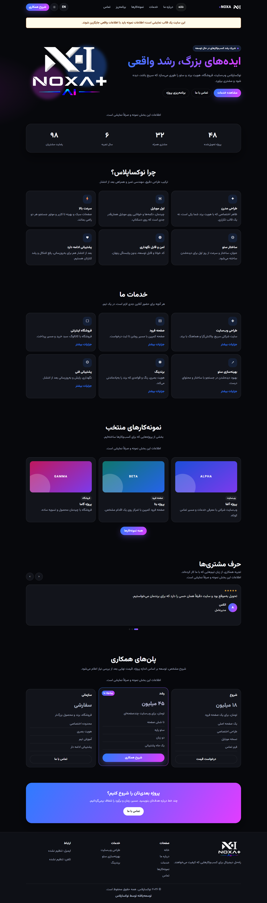
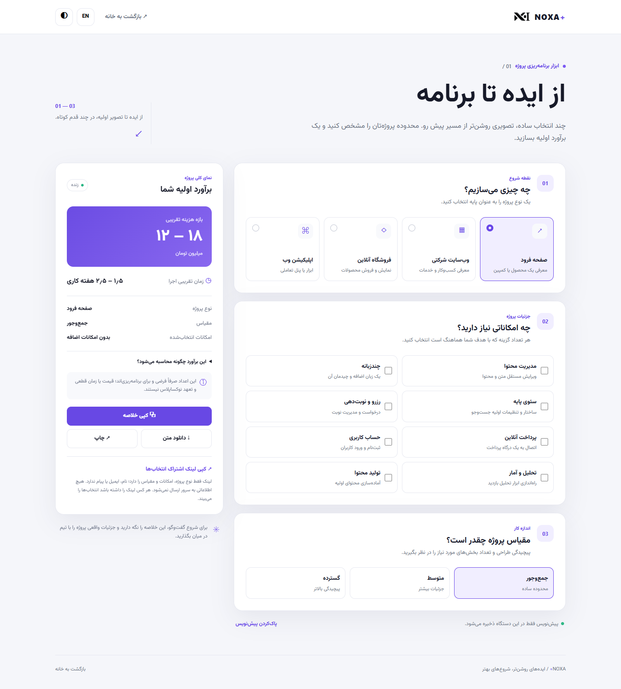
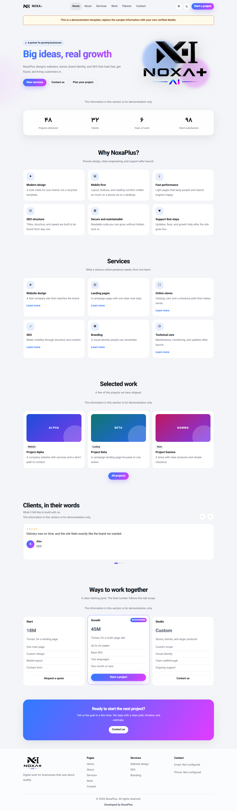
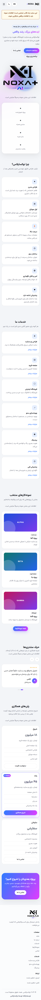
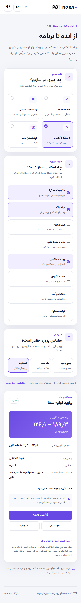

<p align="center">
  
</p>

<h1 align="center">NoxaPlus Business Website</h1>

<p align="center">
  وب‌سایت دوزبانه و واکنش‌گرای شرکتی برای نوکساپلاس — طراحی، فروشگاه، برندینگ و سئو<br>
  <strong>نسخهٔ ۱.۰.۰</strong> · ۱۸ نوامبر ۲۰۲۶
</p>

<p align="center">
  <a href="https://noxaplus-star.github.io/noxaplus-website-business/">دموی زنده</a> ·
  <a href="#ویژگی‌ها">ویژگی‌ها</a> ·
  <a href="#شروع-سریع">شروع سریع</a> ·
  <a href="#تست">تست</a> ·
  <a href="CHANGELOG.md">تغییرات</a>
</p>

> **پروژه به‌روزرسانی شد — نسخهٔ ۱.۰.۰ (۲۰۲۶-۱۱-۱۸):** همهٔ صفحه‌ها بازبینی شدند، خطاهای چیدمان و دسترس‌پذیری برطرف شد و ده قابلیت تازه از جمله برنامه‌ریز پروژه، فرم آماده‌سازی پیام و جست‌وجوی پرسش‌ها اضافه شد. جزئیات در [CHANGELOG.md](CHANGELOG.md).

---

## نگاه کلی

یک وب‌سایت ایستای چندصفحه‌ای با HTML، CSS و جاوااسکریپت خالص؛ بدون مرحلهٔ ساخت، بدون وابستگی و بدون بک‌اند. تمام فونت و تصاویر به‌صورت محلی میزبانی می‌شوند و سایت روی GitHub Pages منتشر شده است.

**دمو:** https://noxaplus-star.github.io/noxaplus-website-business/

| روشن | تیره |
| --- | --- |
|  |  |

| برنامه‌ریز پروژه | نسخهٔ انگلیسی |
| --- | --- |
|  |  |

| موبایل | موبایل — برنامه‌ریز |
| --- | --- |
|  |  |

تصاویر بیشتر: [خدمات](noxaplus-website-business/docs/services.png) · [درباره](noxaplus-website-business/docs/about.png) · [نمونه‌کارها](noxaplus-website-business/docs/portfolio.png) · [تماس](noxaplus-website-business/docs/contact.png) · [برآورد برنامه‌ریز](noxaplus-website-business/docs/planner-estimate.png)

---

## ویژگی‌ها

ده قابلیت اصلی این نسخه:

1. **برنامه‌ریز پروژه** — انتخاب نوع پروژه، امکانات و مقیاس با برآورد زندهٔ هزینه و زمان؛ پیش‌نویس محلی، کپی/دانلود خلاصه، خروجی چاپ و لینک اشتراک بدون اطلاعات شخصی.
2. **دوزبانگی کامل فارسی/انگلیسی** — تغییر متن، عنوان تب و برچسب‌های دسترس‌پذیری؛ انتخاب زبان ماندگار است.
3. **تم روشن و تاریک** — با تعویض خودکار لوگوی مناسب هر تم و ذخیرهٔ انتخاب.
4. **فرم تماس بدون ارسال** — اعتبارسنجی، پذیرش ارقام فارسی، تمرکز روی اولین خطا و ساخت متن قابل‌کپی؛ هیچ داده‌ای به سرور نمی‌رود.
5. **فیلتر نمونه‌کارها و مودال پروژه** — با بستن مودال، فوکوس به کارت قبلی برمی‌گردد.
6. **اسلایدر نظرات** — دکمه‌های ناوبری و نقاط اسلاید با `aria-current` و برچسب شماره.
7. **جست‌وجوی پرسش‌های متداول** — فیلتر زنده با پیام «نتیجه‌ای پیدا نشد».
8. **حرکت‌های ظریف** — نوار پیشرفت اسکرول، شمارندهٔ آمار و ظاهرشدن تدریجی، با احترام به `prefers-reduced-motion` و fallback بدون جاوااسکریپت.
9. **منوی کشویی موبایل** — باز/بستهٔ روان، بستن با Escape و بازگشت فوکوس به دکمهٔ منو.
10. **پرداخت جزئیات دسترس‌پذیری** — لینک پرش به محتوا، حالت فوکوس مرئی، برچسب‌های ARIA و چاپ تمیز خلاصهٔ برنامه‌ریز.

## صفحه‌ها

`index.html` (خانه) · `about.html` (درباره) · `services.html` (خدمات) · `portfolio.html` (نمونه‌کارها) · `contact.html` (تماس و پرسش‌ها) · `planner.html` (برنامه‌ریز پروژه)

---

## شروع سریع

هیچ نصب و ساختی لازم نیست:

```bash
# از پوشهٔ noxaplus-website-business
python -m http.server 8000
# سپس http://localhost:8000
```

یا فایل `noxaplus-website-business/index.html` را در مرورگر باز کنید. (فایل `index.html` در ریشه فقط به پوشهٔ سایت هدایت می‌کند.)

## ساختار

```
NoxaPlus-WebSite-Business/
├─ index.html                 # هدایت به پوشهٔ سایت
├─ CHANGELOG.md
├─ LICENSE                    # MIT
├─ THIRD-PARTY-LICENSES.txt   # فونت وزیرمتن (OFL 1.1)
├─ docs/                      # حریم خصوصی، چک‌لیست تست، متن پرسش‌ها
├─ Media/                     # فایل‌های اصلی لوگو
└─ noxaplus-website-business/
   ├─ index.html, about.html, services.html,
   │  portfolio.html, contact.html, planner.html
   ├─ css/style.css, css/planner.css
   ├─ js/main.js, js/planner.js, js/check-i18n.js
   ├─ assets/brand, assets/fonts, assets/images
   ├─ tests/site.test.cjs
   └─ docs/                    # تصاویر مستندات
```

## سفارشی‌سازی

- **اطلاعات تماس واقعی:** در `contact.html` جای‌نگهدارهای «تنظیم نشده» را با ایمیل، تلفن و شبکه‌های اجتماعی واقعی جایگزین کنید.
- **ترجمه‌ها و متن‌ها:** دیکشنری `translations` در `js/main.js` (کلیدهای فارسی و انگلیسی).
- **رنگ‌ها و تم:** متغیرهای CSS در ابتدای `css/style.css` و بلوک `[data-theme="dark"]`.
- **نرخ‌های برنامه‌ریز:** ثابت‌های ابتدای `js/planner.js` (مبالغ فرضی و قابل تغییر).
- **لوگو:** فایل‌های `assets/brand/`؛ نسخهٔ اصلی در پوشهٔ `Media/`.

> ⚠️ این پروژه یک **قالب نمایشی** است: آمار، نمونه‌کارها، نظرات و برآوردهای برنامه‌ریز فرضی‌اند و در خود سایت هم این موضوع یادآوری می‌شود. فرم تماس چیزی ارسال نمی‌کند.

## تست

```bash
cd noxaplus-website-business
node --check js/main.js
node --check js/planner.js
node --test tests/site.test.cjs   # ۲۷ آزمون ساختاری
node js/check-i18n.js             # بررسی کامل‌بودن ترجمه‌ها
```

۳۵ بررسی مرورگری با Playwright (Chrome) هم اجرا شده است: دوزبانگی، تم، یک‌خطی‌بودن سرفصل در عرض ۳۶۰–۱۹۲۰، منوی موبایل، برنامه‌ریز، فرم تماس، مودال نمونه‌کار و نبود خطای کنسول/شبکه. فهرست کامل: [docs/test-checklist.md](docs/test-checklist.md).

## حریم خصوصی

بدون کوکی، بدون ردیابی و بدون درخواست خارجی؛ فقط سه کلید `localStorage` برای زبان، تم و پیش‌نویس برنامه‌ریز. جزئیات: [docs/privacy.md](docs/privacy.md).

## مجوز

کد پروژه با مجوز [MIT](LICENSE) © 2026 NoxaPlus منتشر شده است. فونت وزیرمتن با مجوز [SIL OFL 1.1](THIRD-PARTY-LICENSES.txt) استفاده می‌شود.

---

## English

**NoxaPlus Business Website** is a bilingual (Persian/English), responsive, multi-page corporate template built with plain HTML, CSS, and vanilla JavaScript — no build step and no dependencies.

**Live demo:** https://noxaplus-star.github.io/noxaplus-website-business/

**Version 1.0.0 — updated 2026-11-18.** See [CHANGELOG.md](CHANGELOG.md).

Highlights: a project planner with live estimates, local drafts, print output, and a privacy-safe share link; full RTL/LTR language switching; light/dark themes with logo swapping; a local-only contact message composer; accessible portfolio filtering and modal; testimonial carousel; FAQ search; scroll progress and reduced-motion-aware reveals; a mobile drawer with Escape handling; and skip-link/keyboard accessibility throughout.

Run locally with `python -m http.server 8000` inside `noxaplus-website-business/`, or open `index.html`. Test with `node --test tests/site.test.cjs` and `node js/check-i18n.js`.

All statistics, portfolio items, testimonials, and planner figures are **sample content** and marked as such in the UI. The contact form does not send anything. Licensed under MIT; the Vazirmatn font is under SIL OFL 1.1.
